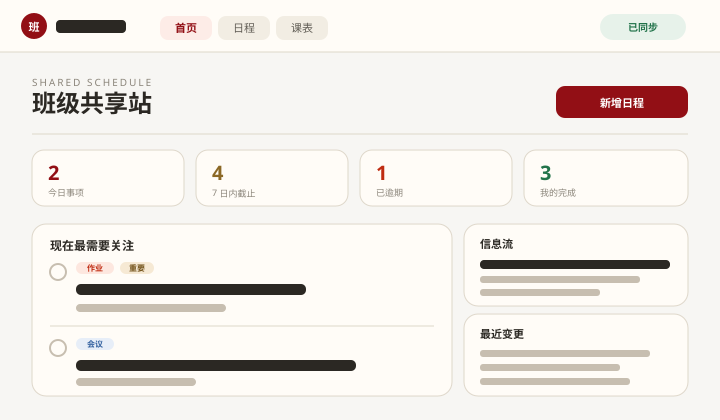
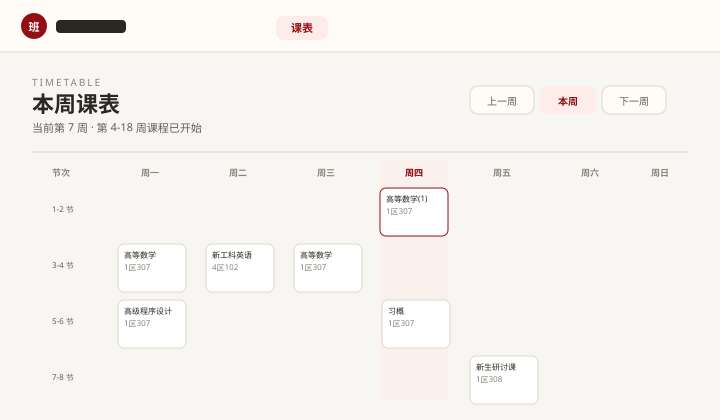
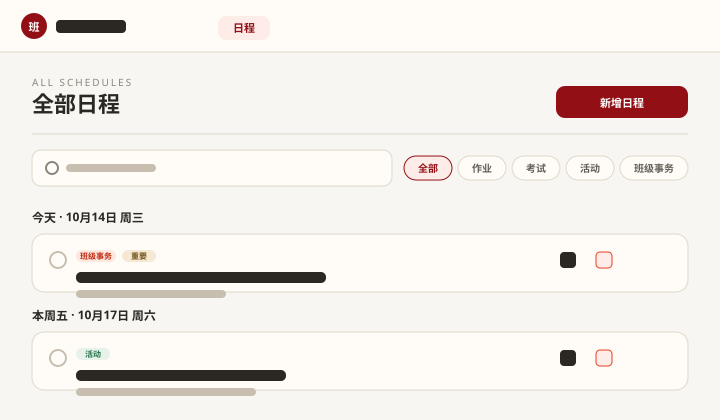
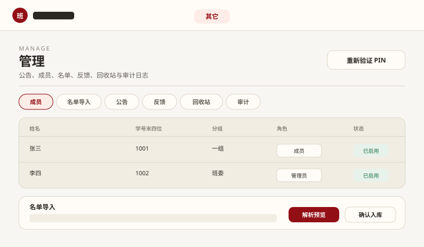

# 班级共享站 (Class Hub)

> A self-hosted class hub for a small student group: roster-gated login, a collaborative schedule board, a weekly timetable with make-up/cancellation handling, announcements, resources and feedback. Node 24 + Fastify + PostgreSQL + React. MIT licensed.

给一个班级（几十人）用的自建共享站：**打开就知道今天要做什么**，改动全班自动同步。

它起源于一个真实的班级需求（山东大学某新工科实验班），但代码本身是通用的 —— 站点名、学校、班级、域名都用配置项填，换个班也能直接用。

> **免责声明**：本项目是学生自建的班级工具，与任何高校**没有隶属关系**，也不包含、不使用任何学校的官方标识（校徽、校名图形等）。

## 界面

> 下图为**界面示意图**（自绘线框，非真实数据截图）。想换成真实截图：用 `npm run dev:demo`（演示数据，不含真实成员信息）截 4 张 PNG，放进 `docs/screenshots/` 并替换下面的文件名即可。

| 首页：今天要做什么 | 课表：本周上什么课 |
| --- | --- |
|  |  |
| **日程：全班共享、协作编辑与冲突提示** | **管理台：成员、名单导入与审计** |
|  |  |

---

## 30 秒试玩（不需要后端）

```bash
npm ci
npm run dev:demo      # 打开 http://127.0.0.1:5173/
```

演示模式用 `localStorage + BroadcastChannel` 模拟数据，**开两个浏览器标签就能看到"A 修改、B 立即同步"**。演示邀请码和班委码在登录页有提示。

## 功能

- **实名白名单登录**：班委导入名单（学号 + 姓名），同学用"学号 + 姓名 + 班级激活码"登录，同一浏览器 30 天免验证。学号只存 HMAC 与末四位，服务端不留明文。
- **共享日程**：今日 / 7 天内截止 / 已逾期 / 最近变更一眼可见；普通日程全班可直接修改，重要日程与公告由管理员锁定；编辑带版本号，冲突时提示"载入最新内容"，不会静默覆盖。
- **课程表**：把教务系统导出的课表另存为 CSV 后粘贴导入，自动按周次推导每天上什么课；支持停课、调课、补课，首页给出提示。
- **公告 / 资料 / 反馈 / 图文教程**：公告支持正文链接自动可点击；资料只存外部链接（不托管课件等版权文件）；成员可提反馈并查看处理状态。
- **管理台**：成员角色与分组、名单导入、公告、反馈、回收站、变更审计与回退；敏感操作需要最近验证过管理员 PIN（系统兜底管理员免验证）。
- **数据边界**：未登录只能看登录说明、公共资料与图文教程；日程、公告、成员信息一律要求登录。

## 技术栈

| 层 | 选型 |
| --- | --- |
| 前端 | React 19 + Vite 8，无 UI 框架，纯 CSS 设计令牌（暖纸色 + 校红金） |
| 后端 | Node.js 24 + Fastify 5 + Zod，Drizzle ORM + node-postgres |
| 数据库 | PostgreSQL 16 |
| 部署 | Docker Compose + Caddy（自动申请并续期 Let's Encrypt 证书） |
| 测试 | `node:test`（纯函数单测，不需要数据库） |
| CI | GitHub Actions（构建 + 单测 + 敏感信息门禁） |

## 目录结构

```text
src/           前端
  config/      站点身份配置（唯一来源，全部走环境变量）
  formal/      正式版数据层：API 客户端、会话上下文、日程/课表逻辑
  components/  formal/（正式版页面）与 demo/（离线演示版页面）
server/        Fastify API：身份与权限、日程、课表、公告/资料/反馈、管理接口
  migrations/  0001 基础 / 0002 正式版业务表 / 0003 课表 / 0004 修复 / 0005 中性默认值
deploy/        Compose、Caddyfile、部署与自检脚本
docs/          架构与部署文档
shared/        前后端共用类型
tests/         前端数据层单测
```

## 环境变量

完整清单见 `.env.example`；**所有站点身份项都可留空**（会用中性默认值）。

| 变量 | 作用 |
| --- | --- |
| `VITE_DATA_MODE` | `remote`（连后端）/ `mock`（离线演示） |
| `VITE_API_TARGET` | 仅本地开发：把 `/api` 代理到后端地址 |
| `VITE_SITE_NAME` / `VITE_BRAND_MARK` | 站点名 / 页头徽标字 |
| `VITE_SCHOOL_NAME` / `VITE_CLASS_NAME` | 页头副标题（学校 + 班级） |
| `VITE_ICP_LICENSE` / `VITE_PUBLIC_SECURITY_*` | 备案号（留空则页脚不显示） |
| `VITE_LEGACY_CACHE_PREFIXES` | 需要清理的历史缓存前缀（从旧版本迁移时用） |

服务端（`server/.env`）：`DATABASE_URL`、`APP_ORIGIN`、`AUTH_SECRET`、`STUDENT_ID_HMAC_KEY`、`CLASS_ACTIVATION_CODE`，可选 `SESSION_COOKIE_NAME`、`FALLBACK_OWNER_*`、`ADMIN_REAUTH_MINUTES`。

## 部署

单机正式版（2 核 4G + 域名 + 自动 HTTPS）见 [`docs/deploy.md`](docs/deploy.md)：

```bash
# 服务器上（已装 Docker 与 Compose v2）
sudo APP_DOMAIN=your-domain.example ACME_EMAIL=you@example.com \
  bash deploy/scripts/deploy-prod-single.sh
```

> 首次部署后，请到 管理 → 资料 里删除或替换内置的示例链接。

## 安全说明

- 学号只保存 HMAC-SHA256 与末四位掩码，明文不落库、不写日志；CSV 导入后用即弃。
- 写请求校验 `Origin`；登录失败按 IP 与学号双维度限流；管理员 PIN 连续输错 5 次锁定 15 分钟。
- 聊天记录之外的东西一律不记：日志不写请求体、Cookie、学号、激活码、管理员 PIN。
- 全站 `noindex, nofollow`；服务端错误对客户端脱敏（只回 requestId，详情只进服务端日志）。
- 仓库自带 `npm run audit:public`，扫描跟踪文件里的密钥/私钥/真实邮箱/学号形态字符串，CI 每次都会跑。

发现安全问题请按 [`SECURITY.md`](SECURITY.md) 私下报告，不要开公开 issue。

## 参与贡献

见 [`CONTRIBUTING.md`](CONTRIBUTING.md)；行为准则见 [`CODE_OF_CONDUCT.md`](CODE_OF_CONDUCT.md)；版本变更见 [`CHANGELOG.md`](CHANGELOG.md)。

## 许可证

[MIT](LICENSE)